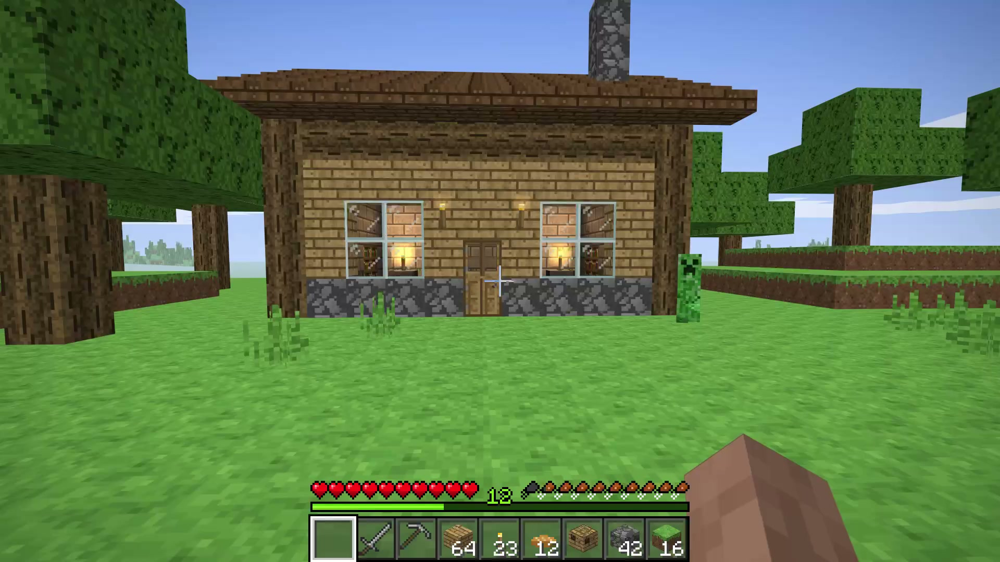
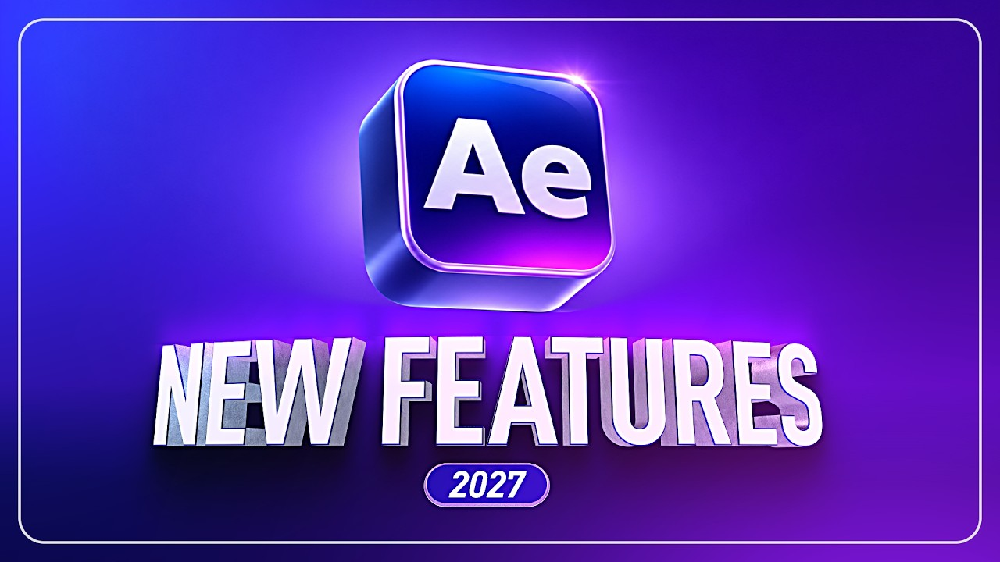

# After Effects AI Hub

**Guides, prompts, update notes and a vetted template directory for using AI agents in Adobe After Effects.**

[**▶ Open the website**](https://raw.githack.com/HossamSalemOnline/after-effects/main/docs/index.html) · [**Atom guide**](content/e01-atom-guide.md) · [**AE 27 updates**](content/e02-after-effects-27-updates.md) · [**Templates directory**](content/e03-after-effects-templates.md) · [**Sources**](sources/SOURCES.md)

---

<!-- AUTO:START (generated by tools/build_site.py; edit sources/entries.json instead) -->

**3 entries · 33 template sources · 21 images stored in the repo**

## Entries

| | Entry | Type | Author | Date |
|---|---|---|---|---|
|  | **[Atom: the complete guide to an AI agent inside After Effects](content/e01-atom-guide.md)** Setup, model choice, prompting rules, a prompt library, skills, MCP Mode, the Atom + Design Mode workflow, 17 free templates and Davey's free tools. Compiled from the docs, the developer's posts and reviews. | Guide | [Compiled guide](https://tryatom.ai/) | 2026-11-24 |
|  | **[After Effects templates and project files: the vetted directory](content/e03-after-effects-templates.md)** 33 sources in three groups (project libraries, single SaaS projects, toolkits), every link opened and checked, with prices and a licence check showing which allow client work. | Directory | [Compiled directory](https://github.com/HossamSalemOnline/after-effects/blob/main/content/e03-after-effects-templates.md) | 2026-11-24 |
|  | **[Every After Effects 27 update worth knowing](content/e02-after-effects-27-updates.md)** Condensed write-up of the full transcript: AI Assistant and its credit cost, 3D materials on text and shapes, Illustrator text, Contour Paint, Quick Apply history and more, with timestamp links. | Video | [Jake In Motion](https://www.youtube.com/channel/UCSggky_jA5RfK4gR5RBwGyw) | 2026-11-23 |

<!-- AUTO:END -->

---

Add a new entry: see [HOW-TO-ADD.md](HOW-TO-ADD.md). Push, and GitHub Actions downloads the images and rebuilds this page and the website.
