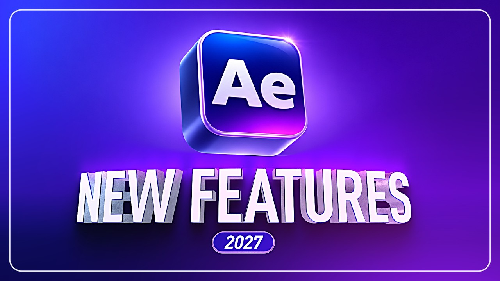

# Every After Effects 27 update worth knowing (Jake In Motion)

 Tap to watch on YouTube · 10m 34s · Jake In Motion · 23 Nov 2026

> **Source:** [All the After Effects 2027 updates you should know about](https://www.youtube.com/watch?v=RcNUE6lg3fE) by [Jake In Motion](https://www.youtube.com/channel/UCSggky_jA5RfK4gR5RBwGyw). This page is a condensed, re-organised write-up of the full transcript, with every timestamp linked so you can jump straight to the demo.

## At a glance

| # | Feature | What it does | Jump to |
|---|---|---|---|
| 1 | **AI Assistant** | Agent inside AE that builds, organises, rigs and writes expressions. Paid in Creative Cloud credits. | [00:00](https://www.youtube.com/watch?v=RcNUE6lg3fE&t=0s) |
| 2 | **Layers as material sources** | Any precomp, footage item or Substance material can texture 3D geometry. | [03:52](https://www.youtube.com/watch?v=RcNUE6lg3fE&t=232s) |
| 3 | **Materials on 3D text and shapes** | Separate materials for front, bevel, side and back. | [04:55](https://www.youtube.com/watch?v=RcNUE6lg3fE&t=295s) |
| 4 | **Preserve Illustrator text** | Converting vector layers keeps text editable. | [07:15](https://www.youtube.com/watch?v=RcNUE6lg3fE&t=435s) |
| 5 | **Adobe Stock panel** | Browse and import Stock without leaving AE. | [07:48](https://www.youtube.com/watch?v=RcNUE6lg3fE&t=468s) |
| 6 | **Contour Paint** | GPU-accelerated painterly effect, out of beta. | [08:01](https://www.youtube.com/watch?v=RcNUE6lg3fE&t=481s) |
| 7 | **De-esser** | New audio effect for harsh "s" sounds. | [08:55](https://www.youtube.com/watch?v=RcNUE6lg3fE&t=535s) |
| 8 | **PNG compression** | Set compression level for PNG sequences. | [09:12](https://www.youtube.com/watch?v=RcNUE6lg3fE&t=552s) |
| 9 | **Quick Apply history** | Last 10 applied effects at the top of Quick Apply. | [09:28](https://www.youtube.com/watch?v=RcNUE6lg3fE&t=568s) |
| 10 | **Better auto-save** | Improved crash recovery. | [10:03](https://www.youtube.com/watch?v=RcNUE6lg3fE&t=603s) |

---

## 1. The AI Assistant

 Frame from around 2:38, during the AI Assistant demo

**How it's paid for.** It spends the generative credits in your Creative Cloud plan. Cost varies with the task and there's no way to predict it upfront.

**How Jake says to use it.** Treat it as an assistant for the grunt work, never as the animator:

- Organising projects
- Writing expressions
- Rigging scenes and building Motion Graphics template (MOGRT) controls
- Anything slow to do by hand that stands between you and the actual keyframing

Asking it to "animate my logo" gives poor results and skips the part of the job that matters.

**The forecast test** ([01:23](https://www.youtube.com/watch?v=RcNUE6lg3fE&t=83s)). From one basic prompt it built and animated a full 10-day weather forecast comp:

| Metric | Result |
|---|---|
| Time | Just over 11 minutes, unattended |
| Credits used | 368 of his 4,000 monthly |
| Output | Fully animated and customisable, with every parameter exposed in the **Essential Graphics** panel as MOGRT controls, ready for Premiere Pro |

**Where the real value is.** Hand it a finished design that's already set up in AE and ask it to rig everything, make it editable and package it as a MOGRT.

**Bring your own model.** Jake wants Adobe to accept existing Claude or ChatGPT subscriptions rather than another credit pool. Until then he recommends the third-party extension **[Atom](https://tryatom.ai/)**, which does exactly that (no affiliate deal). See [E01: the Atom guide](e01-atom-guide.md).

Official Adobe documentation

- [AI Assistant overview](https://helpx.adobe.com/after-effects/desktop/work-with-after-effects-ai-assistant/after-effects-ai-assistant-overview.html)
- [Use the AI Assistant](https://helpx.adobe.com/after-effects/desktop/work-with-after-effects-ai-assistant/use-after-effects-ai-assistant.html)
- [What's new in After Effects](https://helpx.adobe.com/after-effects/desktop/what-s-new/whats-new.html)

---

## 2. Layers as material sources (Advanced 3D)

1. Select the 3D object (Jake uses a rounded cube).
2. In the **Properties** panel, open **Material Options** and switch from *Default* to a layer.
3. Filter the list by **Substance materials**, **precomps** or **footage items**.
4. Pick your source. Jake built a noise precomp with Colorama on top.

The texture stays live. Edit the precomp and the change shows on the geometry straight away, animation included.

## 3. Materials on 3D text and shape layers

 Frame from around 5:17, during the 3D materials demo

1. Open the layer's **Geometry Options → Material Options**.
2. Scroll to the bottom and click **Add override**. Choose *All* to get four slots: **front, bevel, side, back**.
3. Download free **Substance community assets** (the link sits in the material slot of a 3D primitive) and import them.
4. Assign one per slot. Jake's demo: wood on the front, red brick on the sides, galvanised metal on the bevel.
5. Set **Bevel Style** (e.g. Convex), raise the **Extrusion Depth**, then scale each material so patterns read properly.

Shape layers, such as a logo, work the same way. Add an override for just the sides if that's all you need.

## 4. Preserve Illustrator text

Right-click the Illustrator layer → **Create → Create Shapes and Text from Vector Layer**.

| Kept | Lost |
|---|---|
| Live, editable text | Custom kerning |
| Variable fonts | |

For a full one-to-one transfer Jake still uses **[Overlord](https://battleaxe.co/overlord)**.

## 5. Adobe Stock panel

Stock now has its own panel. Search, download and import assets into the project without leaving AE.

## 6. Contour Paint

 Frame from around 7:55, at the Stock panel and Contour Paint section

- Out of beta. Default look is a painterly distortion that works on full video.
- GPU-accelerated and fast to render.
- Has a lot of parameters. Small numeric changes give very different looks.
- Jake's advice: read the user guide, then stack it with other effects. That's where the original looks come from.

## 7. De-esser

A new audio effect that tames sibilance (harsh "s" sounds) inside AE.

## 8. PNG sequence compression

Render Queue → Output Module → **PNG Sequence → PNG Options**. You can now set the compression level.

## 9. Quick Apply history

- Open Quick Apply with **Ctrl+Enter** (Windows) or **Cmd+Enter** (Mac). It opens where your mouse is, and the shortcut can be reassigned.
- Or click the **lightning bolt** icon in the timeline.
- Your **last 10** applied effects now sit at the top of the list.

## 10. Improved auto-save

Better crash recovery. Plus the usual fixes and stability work.

---

## Key takeaways

1. **Use the AI Assistant for setup, not for animation.** Rigging, expressions, organisation and MOGRT packaging are where it saves the most time.
2. **Budget the credits.** One mid-sized build used about 9% of a 4,000-credit month. Single-app plans get far fewer credits ([CG Channel](https://www.cgchannel.com/2026/11/adobe-releases-after-effects-27-0/)).
3. **For heavy AI use, an extension on your own model is cheaper.** [Atom](https://tryatom.ai/) runs on a Claude Code or Codex plan you already pay for.
4. **The 3D materials system now handles real branded 3D type** without leaving AE.

## Links

| Resource | Link |
|---|---|
| The video | [youtube.com/watch?v=RcNUE6lg3fE](https://www.youtube.com/watch?v=RcNUE6lg3fE) |
| Jake In Motion | [YouTube](https://www.youtube.com/channel/UCSggky_jA5RfK4gR5RBwGyw) · [X](https://x.com/jakeinmotion) · [Instagram](https://instagram.com/jakeinmotion) · [Discord](https://discord.com/invite/b5PkuCCCAu) · [jakeinmotion.com](https://jakeinmotion.com) |
| Adobe: what's new | [helpx.adobe.com](https://helpx.adobe.com/after-effects/desktop/what-s-new/whats-new.html) |
| Adobe community launch post | [After Effects 27.0 is here](https://community.adobe.com/announcements-527/after-effects-27-0-is-here-ai-assistant-3d-materials-and-what-to-try-first-1653289) |
| Press coverage | [CG Channel](https://www.cgchannel.com/2026/11/adobe-releases-after-effects-27-0/) · [Digital Production](https://digitalproduction.com/2026/11/17/after-effects-27-an-ai-assistant-because-apparently-we-needed-one/) |
| Atom (recommended in the video) | [tryatom.ai](https://tryatom.ai/) |
